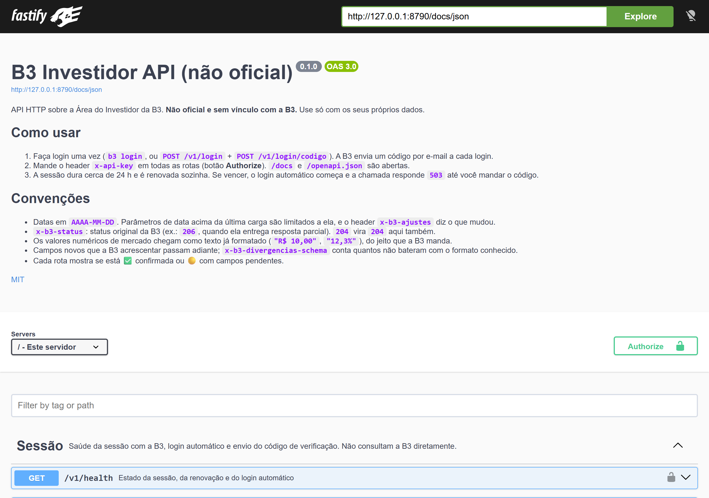
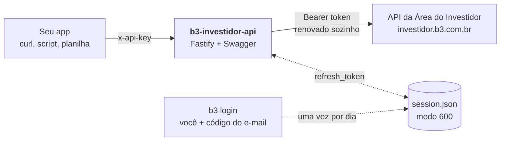
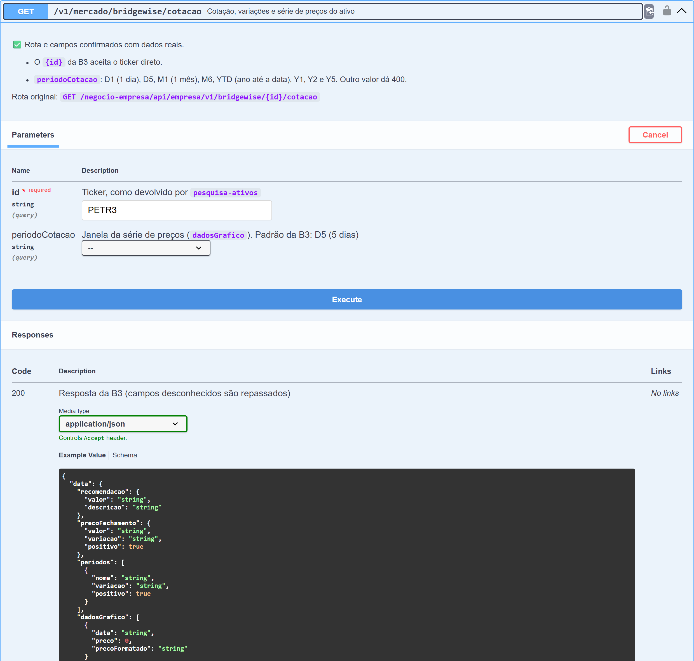
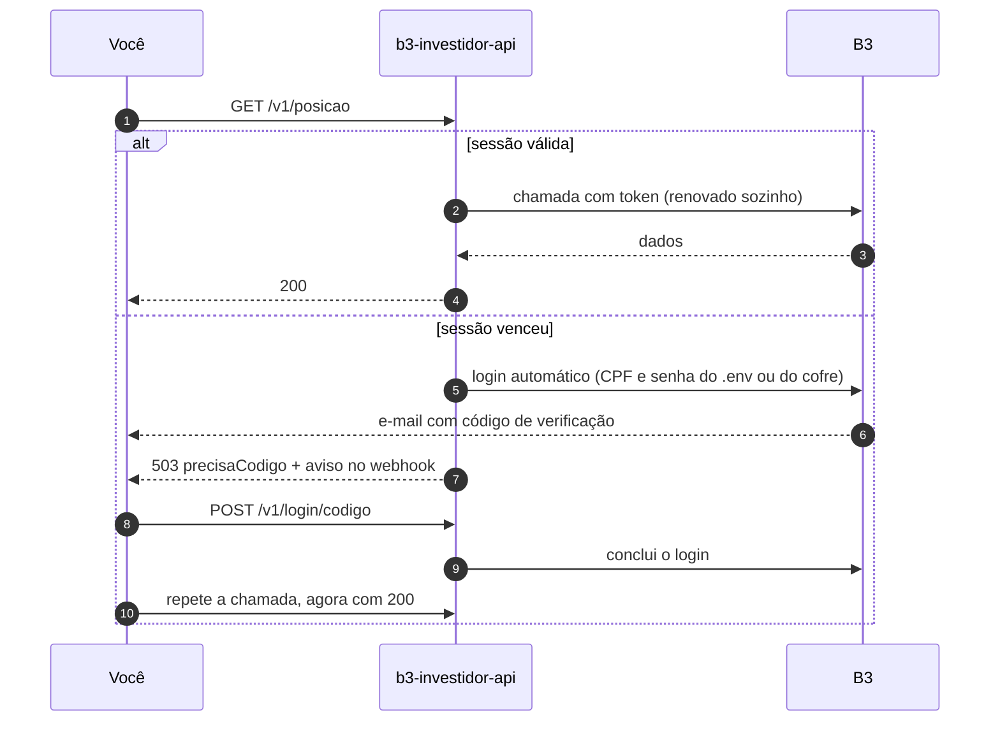

<div align="center">

# b3-investidor-api

**Os seus dados da Área do Investidor da B3, numa API HTTP com Swagger.**<br>
Posição, extratos, proventos, cotações e renda fixa. Direto do portal, com a sua própria conta.

[](https://github.com/Thierrycast/b3-investidor-api/actions/workflows/ci.yml)
[](LICENSE)


</div>

<br>

> [!WARNING]
> **Projeto não oficial, sem nenhum vínculo com a B3.** Ele usa a mesma API interna que o site `investidor.b3.com.br` usa no seu navegador, e ela pode mudar sem aviso.
> Use **só com a sua própria conta**: acessar os próprios dados é um direito seu (LGPD, art. 18).
> O projeto **só lê**. Não compra, não vende, não altera cadastro.

<div align="center">
  
</div>

<br>

## Por que existe

O portal da B3 mostra tudo o que você precisa, mas não oferece uma API. Este projeto faz o que o seu navegador faz e entrega o resultado em JSON, documentado:

- 📈 **Carteira e extratos**: posição numa data, movimentações, negociações, evolução do patrimônio.
- 💰 **Proventos**: dividendos, JCP e rendimentos, recebidos e a receber.
- 🔎 **Mercado**: cotação, indicadores, análise fundamentalista e técnica de qualquer ativo.
- 🏦 **Renda fixa**: títulos públicos, debêntures, CRA, CRI e cálculo de preço unitário (PU).
- 🔐 **Sessão sem dor**: renova sozinha e refaz o login quando vence. O código do e-mail continua sendo seu.

## Como funciona



A B3 só responde a quem está logado. Por isso há um passo humano: o **código de verificação** que ela manda por e-mail a cada login. O projeto nunca contorna isso nem o CAPTCHA.

## Começo rápido

Precisa de **Node 22+**, **pnpm** e do **Chrome ou Edge** instalado (só para o login).

```bash
git clone https://github.com/Thierrycast/b3-investidor-api.git
cd b3-investidor-api
pnpm install
cp .env.example .env
```

**1. Entre uma vez**

```bash
pnpm b3 credenciais salvar   # opcional: guarda CPF e senha cifrados no cofre do sistema
pnpm b3 login                # a B3 manda um código por e-mail; cole no terminal
```

Não chegou o e-mail? Digite `r` no lugar do código para pedir outro.

**2. Confira**

```bash
pnpm b3 probe                # renova a sessão e mostra só status e tipos, nunca valores
```

**3. Suba a API**

```bash
B3_API_KEY=$(openssl rand -hex 32) pnpm b3 serve
```

Abra **http://127.0.0.1:8790/docs**, clique em **Authorize**, cole a chave e use o **Try it out**.

```bash
curl -H "x-api-key: $B3_API_KEY" "http://127.0.0.1:8790/v1/mercado/bridgewise/cotacao?id=PETR3&periodoCotacao=M1"
curl -H "x-api-key: $B3_API_KEY" "http://127.0.0.1:8790/v1/renda-fixa/calculo-pu?codigo=AAJR11"
curl -H "x-api-key: $B3_API_KEY" "http://127.0.0.1:8790/v1/movimentacao?todasPaginas=true"
```

<details>
<summary><b>Prefere usar como biblioteca TypeScript?</b></summary>

<br>

```ts
import { B3Client } from "@b3-investidor/core";

const b3 = new B3Client();                                   // lê ~/.config/b3-investidor/session.json
const posicao = await b3.call("posicao");                    // data padrão = última carga da B3
const cotacao = await b3.call("bridgewiseCotacao", { id: "PETR3", periodoCotacao: "M1" });
const extrato = await b3.all("movimentacao", { dataInicio: "2025-01-01" });   // todas as páginas
```

Os parâmetros e as respostas são tipados a partir dos schemas [zod](https://zod.dev) do registro.

</details>

## O que a API entrega

**37 rotas**, todas `GET`. ✅ = campos confirmados com dados reais · 🟡 = rota funciona, mas campos dos itens ainda não foram vistos (veja [como ajudar](#ajude-a-completar-o-mapa)).

<table>
<tr><th width="150">Assunto</th><th>Rotas</th></tr>

<tr><td><b>📈 Carteira</b></td><td>
✅ <code>/v1/posicao</code> posição numa data<br>
✅ <code>/v1/carteira/resumo</code> · <code>total-acumulado</code> · <code>instituicoes</code> · <code>evolucao</code>
</td></tr>

<tr><td><b>🧾 Extratos</b></td><td>
✅ <code>/v1/movimentacao</code> · <code>/v1/movimentacao/ultimas</code><br>
🟡 <code>/v1/negociacao</code> · <code>/v1/negociacao/ultimas</code>
</td></tr>

<tr><td><b>💰 Proventos</b></td><td>
✅ <code>/v1/proventos/meses</code> · <code>recebidos/resumo</code> · <code>tipos-eventos</code><br>
🟡 <code>/v1/proventos</code> · <code>resumo</code> · <code>anos</code> · <code>tipos-investimentos</code> · <code>recebidos/mensal</code>
</td></tr>

<tr><td><b>🔎 Mercado</b></td><td>
✅ <code>/v1/mercado/bridgewise/</code> <code>pesquisa-ativos</code> · <code>cotacao</code> · <code>dados-ativo</code> · <code>desempenho</code> · <code>comparativo</code> · <code>analise-fundamentalista</code> · <code>analise-tecnica</code><br>
🟡 <code>/v1/mercado/bridgewise/lista-ativos</code> (os ativos da <i>sua</i> carteira)
</td></tr>

<tr><td><b>🏦 Renda fixa</b></td><td>
✅ <code>/v1/renda-fixa/</code> <code>titulos-publicos</code> · <code>debentures</code> · <code>cra</code> · <code>cri</code> · <code>calculo-pu</code>
</td></tr>

<tr><td><b>👤 Investidor</b></td><td>
✅ <code>/v1/investidor/</code> <code>cadastro</code> · <code>perfil</code> · <code>menus</code> · <code>instituicoes</code> · <code>tipos-movimentacoes</code>
</td></tr>

<tr><td><b>🔁 Transferência</b></td><td>
🟡 <code>/v1/transferencia/listados-balcao</code>
</td></tr>

<tr><td><b>⚙️ Sistema</b></td><td>
✅ <code>/v1/sistema/ultima-carga</code> datas da última carga de dados da B3
</td></tr>
</table>

Cada rota tem parâmetros, respostas e erros documentados. A lista completa, campo a campo, está em **[docs/endpoints.md](docs/endpoints.md)** (gerada do código) e no Swagger:

<div align="center">
  
</div>

## A sessão, sem você pensar nela

A API se comporta como uma aplicação comum:



- A sessão dura **cerca de 24 h** a partir do login e não dá para estendê-la. Na prática, é um código de e-mail por dia.
- Sem credenciais configuradas, o login automático fica desligado e a API responde `401` com `precisaLogin`. Rode `b3 login`.
- Detalhes, incluindo o fluxo de login da B3 passo a passo, em **[docs/auth.md](docs/auth.md)**.

## Coisas que vale saber

| | |
|---|---|
| 📅 **Datas** | A B3 só aceita até a **última carga** (normalmente o dia útil anterior). O projeto usa a data da carga como padrão e limita datas maiores; o header `x-b3-ajustes` diz o que mudou. |
| 🔤 **Valores de mercado** | Chegam como texto já formatado (`"R$ 10,00"`, `"12,3%"`), do jeito que a B3 manda. Posição e extratos trazem os números crus. |
| 🧩 **Campos novos** | Os schemas são abertos: o que a B3 acrescentar passa adiante sem quebrar. `x-b3-divergencias-schema` conta o que não bateu. |
| 📬 **Status originais** | `x-b3-status` informa o status da B3 (ex.: `206`, resposta parcial). Erros dela viram `4xx` ou `502` com o corpo explicado. |
| 🚧 **Fora do ar na B3** | A **renda fixa de mercado** (`ativos`, `negócios`) responde 500 no serviço da B3 e ficou fora até voltar. Veja o [ROADMAP](ROADMAP.md). |

## Como o repositório é organizado

| Pacote | Para quê |
|---|---|
| [`@b3-investidor/core`](packages/core) | Cliente tipado: autenticação Azure AD B2C, renovação, registro de rotas com schemas zod, paginação e erros |
| [`@b3-investidor/server`](packages/server) | API HTTP (Fastify) com Swagger em `/docs`, chave de acesso e renovação automática |
| [`@b3-investidor/cli`](packages/cli) | O comando `b3`: `login`, `credenciais`, `refresh`, `probe`, `shapes`, `discover`, `endpoints`, `serve` |
| [`@b3-investidor/login`](packages/login) | Login assistido (Playwright com o seu Chrome/Edge) e cofre de credenciais do sistema |

## Configuração

Tudo no `.env` (copie de [`.env.example`](.env.example)). O essencial:

| Variável | Para quê | Padrão |
|---|---|---|
| `B3_API_KEY` | Chave do header `x-api-key` (mínimo 16 caracteres) | **obrigatória** no `serve` |
| `B3_CPF` · `B3_SENHA` | Login automático. Alternativa mais segura: `b3 credenciais salvar` | cofre do sistema |
| `B3_SESSION_FILE` | Onde fica o `refresh_token` | `~/.config/b3-investidor/session.json` |
| `B3_HOST` · `B3_PORT` | Onde o servidor escuta | `127.0.0.1` · `8790` |
| `B3_AUTO_LOGIN` | `0` desliga o login automático | `1` |
| `B3_ALERT_WEBHOOK` | Recebe um `POST` quando falta o código, o login falha ou a sessão está perto de vencer | vazio |

## Ajude a completar o mapa

O projeto foi construído com uma conta que só tinha renda fixa. Por isso ações, FIIs, BDRs, ETFs, proventos e negociações têm campos desconhecidos (as rotas 🟡). **Quem tem esses ativos consegue ajudar sem expor nenhum dado:**

```bash
pnpm b3 shapes --all                       # imprime só a árvore de TIPOS, nunca valores
pnpm b3 shapes bridgewiseCotacao -q id=PETR3
pnpm b3 discover                           # abre o portal e mapeia rotas novas enquanto você navega
```

Cole o resultado numa [issue](https://github.com/Thierrycast/b3-investidor-api/issues/new/choose) e pronto. Também aceitamos código: o caminho está em **[CONTRIBUTING.md](CONTRIBUTING.md)**, e o que falta fazer, em **[ROADMAP.md](ROADMAP.md)**. Já foram mapeadas 135 rotas do portal ([docs/mapa-rotas.md](docs/mapa-rotas.md)); sobram dezenas para implementar.

## Segurança e privacidade

- 🔒 Tokens ficam só na sua máquina (`session.json` com modo 600) ou no armazenamento que você implementar.
- 📡 Sem telemetria. O código só fala com `b3investidor.b2clogin.com` e `investidor.b3.com.br`.
- 🛡️ O servidor escuta em `127.0.0.1`, exige `x-api-key` e oculta credenciais nos logs.
- 🚫 O projeto não resolve CAPTCHA nem o código de verificação: ele sempre vem de você.

Achou uma vulnerabilidade? Veja o [SECURITY.md](SECURITY.md) e **não abra issue pública**.

## Licença

[MIT](LICENSE) © 2026 Thierry Castro. Use, modifique e distribua à vontade, com o aviso de copyright.

*B3, Brasil, Bolsa, Balcão e Área do Investidor são marcas da B3 S.A. Este projeto é independente e não é afiliado, endossado nem mantido pela B3.*
